

  
  

<table>
  <tr>
    <td width="28%" align="center" valign="middle">
      
    </td>
    <td width="72%" valign="middle">
      <a href="https://github.com/kakashsunny">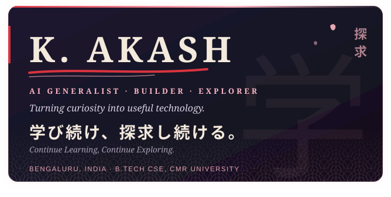</a>
      
    </td>
  </tr>
</table>

  

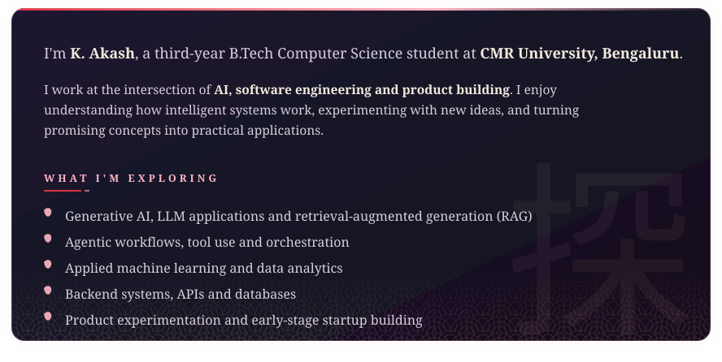

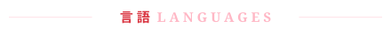

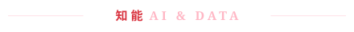

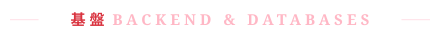

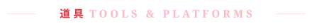

  
  
  
  
  
  

These include concepts, prototypes and hackathon builds. Project status and implementation depth vary; check each repository for the latest details.

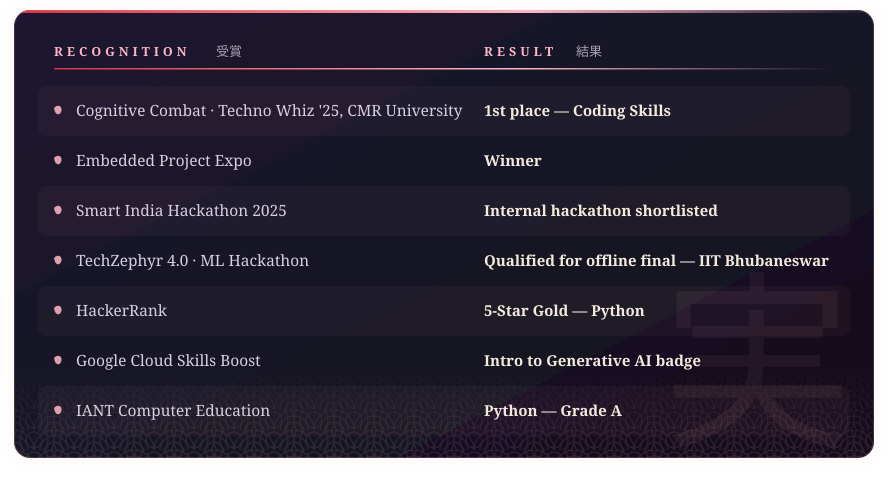

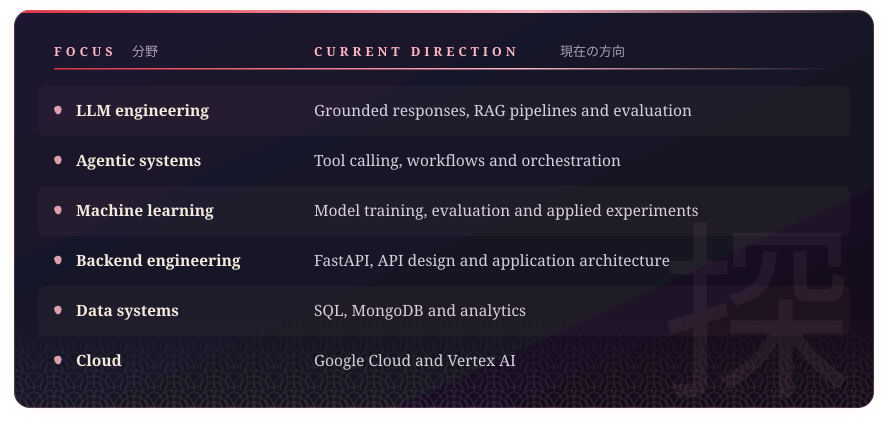

  <picture>
    <source media="(prefers-color-scheme: dark)" srcset="https://raw.githubusercontent.com/kakashsunny/kakashsunny/output/github-snake-sakura.svg" />
    
  </picture>

  

  
  

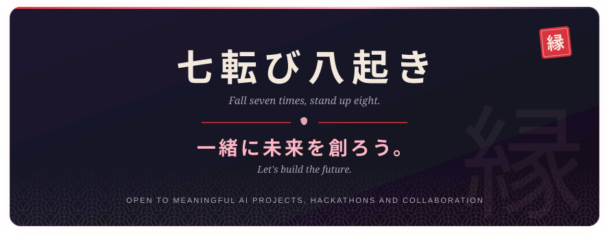

